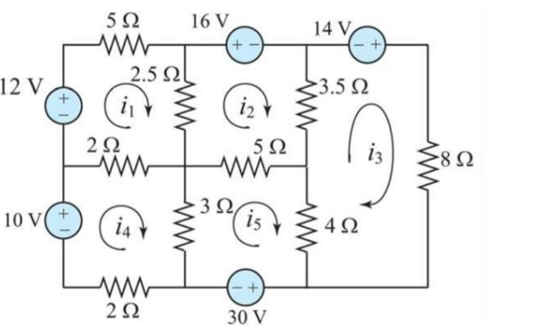

# Roteiro de Solução – Atividade Complementar de Cálculo Numérico (2026.2)

**Questões:** 01.3 (Métodos diretos) · 02.3 (Métodos iterativos) · 03.1 (Mínimos quadrados) · 04.2 (Integração numérica)

**Programa:** `python main.py`. Em cada questão, escolha *1) Usar os dados do enunciado* ou *2) Digitar novos dados*.

---

## Como o programa está organizado

### Passo 1 – Separação em camadas

O código foi dividido para que cada arquivo tenha **uma única responsabilidade**:

```
main.py                  só chama executar()
interface.py             menu principal e fluxo de cada questão
entrada.py               lê e valida o que o usuário digita
apresentacao.py          formata números e imprime tabelas/sistemas
calculo/                 OS MÉTODOS NUMÉRICOS (não sabem nada do enunciado)
  diretos.py             eliminacao_de_gauss, residuo_maximo
  iterativos.py          gauss_seidel, criterio_de_sassenfeld, aproximacao_inicial
  ajuste.py              ajustar_reta, erro_quadratico, coeficiente_r2
  integracao.py          trapezio_repetido, simpson_repetido, passo_constante
problemas/               UMA QUESTÃO POR ARQUIVO (dados + resolver + mostrar)
  minas.py · circuito.py · moore.py · rio.py
tests/                   testes automáticos (pytest)
```

A pasta `calculo/` tem só a matemática. Por isso, os mesmos métodos servem para qualquer problema do mesmo tipo, que é o que o enunciado pede. A pasta `problemas/` traduz cada enunciado para esses métodos.

### Passo 2 – O "contrato" de cada questão

Cada arquivo em `problemas/` tem sempre os mesmos nomes:

| Nome | O que é |
|---|---|
| `TITULO`, `ENUNCIADO` | textos mostrados no menu |
| `DADOS_DO_ENUNCIADO` | os dados do PDF, já digitados |
| `ler_novos_dados()` | pede ao usuário dados de outro problema do mesmo tipo |
| `resolver(dados)` | chama o método numérico e devolve o resultado |
| `mostrar(dados, resultado)` | imprime o sistema, as tabelas e a resposta |

Como todas as questões seguem esse contrato, a interface trata as quatro do mesmo jeito.

### Passo 3 – O fluxo do programa (`interface.py`)

```python
QUESTOES = {"1": minas, "2": circuito, "3": moore, "4": rio}

def _executar_questao(questao) -> bool:
    """Retorna False quando o usuário escolhe sair do programa."""
    while True:
        console.print(Panel(questao.ENUNCIADO, title=questao.TITULO, border_style="cyan"))
        console.print("  1) Usar os dados do enunciado\n  2) Digitar novos dados")
        if ler_opcao("Escolha:", {"1", "2"}) == "1":
            dados = questao.DADOS_DO_ENUNCIADO
        else:
            dados = questao.ler_novos_dados()
        try:
            questao.mostrar(dados, questao.resolver(dados))
        except (ValueError, ZeroDivisionError, OverflowError) as erro:
            console.print(f"[red]Não foi possível calcular: {erro}")

        console.print("\n  1) Novo cálculo  2) Voltar ao menu  0) Sair")
        acao = ler_opcao("Escolha:", {"1", "2", "0"})
        if acao != "1":
            return acao == "2"
```

O que acontece, em ordem:

1. O dicionário `QUESTOES` liga a opção do menu ao **módulo** da questão.
2. O enunciado aparece num painel.
3. O usuário escolhe entre os dados do enunciado e dados novos (`ler_novos_dados()`).
4. A linha `questao.mostrar(dados, questao.resolver(dados))` **calcula e exibe**.
5. Se o método falhar (sistema singular, número de pontos errado etc.), o `try/except` mostra a mensagem em vermelho e o programa **não fecha**.
6. No fim, o usuário escolhe **novo cálculo**, **voltar** ou **sair**.

### Passo 4 – Entrada de dados (`entrada.py`)

```python
def converter_numero(texto: str) -> float:
    valor = float(texto.strip().replace(",", "."))
    if not math.isfinite(valor):
        raise ValueError
    return valor

def ler_lista(pergunta: str, tamanho: int | None = None, minimo: int = 2) -> list[float]:
    """Valores separados por espaço ou ';'. Ex.: 0,55 0,25 0,25"""
    while True:
        texto = console.input(f"{pergunta}: ").replace(";", " ")
        try:
            valores = [converter_numero(parte) for parte in texto.split()]
        except ValueError:
            console.print("[red]Há um valor inválido. Separe os números por espaço ou ';'.")
            continue
        if tamanho is not None and len(valores) != tamanho:
            console.print(f"[red]Digite exatamente {tamanho} valores (você digitou {len(valores)}).")
        elif len(valores) < minimo:
            console.print(f"[red]Digite pelo menos {minimo} valor(es).")
        else:
            return valores
```

- `converter_numero` troca a vírgula por ponto, então o usuário pode digitar `0,55`. Também recusa `inf` e `nan`.
- `ler_lista` repete a pergunta (`while True`) até receber uma lista válida, com a quantidade certa de números. Uma linha de matriz, por exemplo, é só uma `ler_lista` com `tamanho = n`.

### Passo 5 – Saída (`apresentacao.py`)

```python
def formatar(valor: float, casas: int = 4) -> str:
    """Formata no padrão brasileiro: 1234.5 -> 1.234,5000"""
    texto = f"{valor:,.{casas}f}"
    return texto.replace(",", "_").replace(".", ",").replace("_", ".")
```

O Python formata como `1,234.5000`. A função troca vírgula e ponto, usando `_` como marcador temporário, e o resultado fica `1.234,5000`. Além disso, `mostrar_sistema` escreve o sistema linear na tela, equação por equação.

---

## Questão 01.3 – Quantos m³ minerar de cada mina

### Passo 1 – Entender o problema

O engenheiro precisa de **4.800 m³ de areia**, **5.800 m³ de cascalho fino** e **5.700 m³ de cascalho grosso**. Cada mina fornece esses materiais em proporções fixas:

| | Areia (%) | Cascalho fino (%) | Cascalho grosso (%) |
|---|---|---|---|
| Mina 1 | 55 | 30 | 15 |
| Mina 2 | 25 | 45 | 30 |
| Mina 3 | 25 | 20 | 55 |

### Passo 2 – Montar o sistema linear (item a)

Incógnitas: **x₁, x₂, x₃** = m³ minerados das minas 1, 2 e 3.

Cada material dá uma equação. A quantidade vinda de cada mina é a sua porcentagem vezes o volume minerado:

```
Areia:            0,55x₁ + 0,25x₂ + 0,25x₃ = 4800
Cascalho fino:    0,30x₁ + 0,45x₂ + 0,20x₃ = 5800
Cascalho grosso:  0,15x₁ + 0,30x₂ + 0,55x₃ = 5700
```

Repare que as **colunas** da matriz são as composições das minas e as **linhas** são os materiais.

### Passo 3 – Método escolhido (item b): Eliminação de Gauss com pivoteamento parcial

1. **Pivoteamento:** em cada coluna k, troca-se a linha atual pela linha com o maior |aᵢₖ|. Isso evita dividir por números pequenos.
2. **Eliminação:** para cada linha i abaixo do pivô, calcula-se o multiplicador mᵢₖ = aᵢₖ / aₖₖ e faz-se Lᵢ ← Lᵢ − mᵢₖ·Lₖ.
3. **Substituição regressiva:** resolve-se o sistema triangular de baixo para cima.

### Passo 4 – Cálculos

Matriz aumentada inicial:

```
[ 0,55  0,25  0,25 | 4800 ]
[ 0,30  0,45  0,20 | 5800 ]
[ 0,15  0,30  0,55 | 5700 ]
```

**Coluna 1.** O pivô é 0,55, que já é o maior, então não há troca.

- m₂₁ = 0,30/0,55 = 0,545455 → L₂ ← L₂ − 0,545455·L₁
- m₃₁ = 0,15/0,55 = 0,272727 → L₃ ← L₃ − 0,272727·L₁

```
[ 0,55  0,250000  0,250000 | 4800,000000 ]
[ 0     0,313636  0,063636 | 3181,818182 ]
[ 0     0,231818  0,481818 | 4390,909091 ]
```

**Coluna 2.** O pivô é 0,313636 (maior que 0,231818), então não há troca.

- m₃₂ = 0,231818/0,313636 = 0,739130 → L₃ ← L₃ − 0,739130·L₂

```
[ 0,55  0,250000  0,250000 | 4800,000000 ]
[ 0     0,313636  0,063636 | 3181,818182 ]
[ 0     0         0,434783 | 2039,130435 ]
```

**Substituição regressiva:**

```
x₃ = 2039,130435 / 0,434783                          = 4690,00
x₂ = (3181,818182 − 0,063636·4690) / 0,313636        = 9193,33
x₁ = (4800 − 0,25·9193,33 − 0,25·4690) / 0,55        = 2416,67
```

### Passo 5 – Verificação

Substituindo no sistema, 0,55·2416,67 + 0,25·9193,33 + 0,25·4690 = 4800 ✓. O programa calcula o resíduo max|A·x − b| ≈ 0.

### Passo 6 – Como o código faz isso

**6.1 – Guardar os dados (`problemas/minas.py`)**

```python
@dataclass
class DadosMinas:
    materiais: list[str]
    composicao_por_mina: list[list[float]]   # em %
    volumes_necessarios: list[float]

DADOS_DO_ENUNCIADO = DadosMinas(
    materiais=["Areia", "Cascalho fino", "Cascalho grosso"],
    composicao_por_mina=[[55, 30, 15], [25, 45, 30], [25, 20, 55]],
    volumes_necessarios=[4800, 5800, 5700],
)
```

Os dados ficam como estão na tabela do enunciado: **uma lista por mina**, em porcentagem. A `@dataclass` só agrupa os três campos com nomes claros.

**6.2 – Montar a matriz A (`montar_sistema`)**

```python
def montar_sistema(dados: DadosMinas) -> list[list[float]]:
    """Linha i = material i; coluna j = fração do material i na mina j."""
    quantidade = len(dados.materiais)
    return [[mina[i] / 100 for mina in dados.composicao_por_mina] for i in range(quantidade)]
```

- Para cada material `i`, percorre as minas e pega `mina[i] / 100`, a fração desse material na mina.
- O resultado é a tabela **transposta** e dividida por 100: a linha 0 fica `[0.55, 0.25, 0.25]`, que é a equação da areia.
- Com isso, o usuário digita a composição de cada mina e o código monta as equações sozinho.

**6.3 – Resolver (`resolver`)**

```python
def resolver(dados: DadosMinas) -> list[float]:
    return eliminacao_de_gauss(montar_sistema(dados), dados.volumes_necessarios)
```

**6.4 – A Eliminação de Gauss (`calculo/diretos.py`)**

```python
def eliminacao_de_gauss(matriz, termos):
    aumentada = [linha[:] + [termo] for linha, termo in zip(matriz, termos)]   # (1)
    n = len(aumentada)
    for coluna in range(n):                                                    # (2)
        _trocar_pela_linha_de_maior_pivo(aumentada, coluna)                    # (3)
        pivo = aumentada[coluna][coluna]
        if abs(pivo) < LIMITE_DE_PIVO_NULO:                                    # (4)
            raise ValueError("Sistema singular: não possui solução única.")
        for linha in range(coluna + 1, n):                                     # (5)
            fator = aumentada[linha][coluna] / pivo
            aumentada[linha] = [a - fator * p for a, p in zip(aumentada[linha], aumentada[coluna])]
    return _substituicao_regressiva(aumentada)                                 # (6)
```

1. **Matriz aumentada [A | b]:** cada linha é copiada (`linha[:]`) e recebe o termo independente no fim. A cópia evita alterar a matriz original.
2. **Laço das colunas:** em cada volta, a coluna atual é zerada abaixo da diagonal.
3. **Pivoteamento parcial:** traz para cima a linha com o maior |valor| nessa coluna (veja abaixo).
4. **Pivô ≈ 0:** se nem o maior valor da coluna serve como pivô, o sistema não tem solução única. O erro é avisado, e o programa não trava.
5. **Eliminação:** para cada linha abaixo do pivô, `fator` é o multiplicador mᵢₖ. A list comprehension faz **Lᵢ ← Lᵢ − mᵢₖ·Lₖ** elemento a elemento.
    - Na questão, na volta `coluna = 0`, temos `fator = 0,30/0,55 = 0,545455` para a linha 2 e `0,15/0,55 = 0,272727` para a linha 3.
    - Na volta `coluna = 1`, temos `fator = 0,739130`. Esses são exatamente os valores calculados à mão no Passo 4.
6. **Substituição regressiva:** resolve o sistema que ficou triangular.

```python
def _trocar_pela_linha_de_maior_pivo(aumentada, coluna):
    linha_do_pivo = max(range(coluna, len(aumentada)), key=lambda i: abs(aumentada[i][coluna]))
    aumentada[coluna], aumentada[linha_do_pivo] = aumentada[linha_do_pivo], aumentada[coluna]
```

O `max(..., key=...)` procura, da linha `coluna` para baixo, qual tem o maior valor absoluto. A troca é feita numa única linha com a atribuição múltipla do Python.

```python
def _substituicao_regressiva(triangular):
    n = len(triangular)
    solucao = [0.0] * n
    for i in reversed(range(n)):                                   # de baixo para cima
        soma = sum(triangular[i][j] * solucao[j] for j in range(i + 1, n))
        solucao[i] = (triangular[i][n] - soma) / triangular[i][i]
    return solucao
```

Aqui está a fórmula xᵢ = (bᵢ − Σⱼ>ᵢ aᵢⱼxⱼ) / aᵢᵢ:

- `reversed` começa pela última linha.
- `soma` junta os termos das variáveis já encontradas.
- `triangular[i][n]` é o termo independente (última coluna da matriz aumentada).

**6.5 – Verificação (`residuo_maximo`)**

```python
def residuo_maximo(matriz, solucao, termos):
    return max(abs(sum(a * x for a, x in zip(linha, solucao)) - b)
               for linha, b in zip(matriz, termos))
```

Multiplica cada linha de A pela solução e compara com b. O maior erro aparece na tela (≈ 0 neste problema).

**6.6 – Exibir (`mostrar`)**

A função `mostrar` faz três coisas:

1. Imprime o sistema montado (item a).
2. Imprime a tabela com o volume de cada mina.
3. Avisa se algum volume deu negativo, o que significa que a demanda não pode ser atendida com essas minas.

### Resposta (item c)

| Mina | Volume a minerar |
|---|---|
| Mina 1 | **2.416,67 m³** |
| Mina 2 | **9.193,33 m³** |
| Mina 3 | **4.690,00 m³** |

---

## Questão 02.3 – Correntes de malha (Gauss-Seidel)



### Passo 1 – Aplicar a Lei das Malhas de Kirchhoff (item a)

Convenções adotadas:

- Todas as correntes de malha i₁…i₅ circulam no **sentido horário**, como na figura.
- Num resistor compartilhado por duas malhas, a corrente é a diferença entre elas: por exemplo, o 2,5 Ω entre as malhas 1 e 2 é percorrido por (i₁ − i₂).
- A regra é **Σ (quedas R·i) = Σ (fontes)**. Uma fonte conta como positiva quando, no sentido da malha, se passa do − para o + (ganho de tensão).

| Malha | Elementos percorridos | Equação |
|---|---|---|
| 1 | 5 Ω, 2,5 Ω (com i₂), 2 Ω (com i₄), fonte 12 V (−→+) | 5i₁ + 2,5(i₁−i₂) + 2(i₁−i₄) = 12 |
| 2 | fonte 16 V (+→−), 3,5 Ω (com i₃), 5 Ω (com i₅), 2,5 Ω (com i₁) | 2,5(i₂−i₁) + 3,5(i₂−i₃) + 5(i₂−i₅) = −16 |
| 3 | fonte 14 V (−→+), 8 Ω, 4 Ω (com i₅), 3,5 Ω (com i₂) | 3,5(i₃−i₂) + 8i₃ + 4(i₃−i₅) = 14 |
| 4 | 2 Ω (com i₁), 3 Ω (com i₅), 2 Ω, fonte 10 V (−→+) | 2(i₄−i₁) + 3(i₄−i₅) + 2i₄ = 10 |
| 5 | 5 Ω (com i₂), 4 Ω (com i₃), fonte 30 V (+→−), 3 Ω (com i₄) | 5(i₅−i₂) + 4(i₅−i₃) + 3(i₅−i₄) = −30 |

Agrupando os termos, o sistema fica:

```
 9,5i₁ − 2,5i₂            − 2i₄          =  12
−2,5i₁ + 11i₂  − 3,5i₃           − 5i₅   = −16
       − 3,5i₂ + 15,5i₃          − 4i₅   =  14
−2i₁                     + 7i₄   − 3i₅   =  10
       − 5i₂   − 4i₃     − 3i₄   + 12i₅  = −30
```

A matriz é **simétrica**, e na diagonal fica a soma das resistências de cada malha. Isso confirma a montagem.

### Passo 2 – Verificar a convergência (Critério de Sassenfeld)

```
β₁ = (2,5 + 2) / 9,5                          = 0,474
β₂ = (2,5·β₁ + 3,5 + 5) / 11                  = 0,880
β₃ = (3,5·β₂ + 4) / 15,5                      = 0,457
β₄ = (2·β₁ + 3) / 7                           = 0,564
β₅ = (5·β₂ + 4·β₃ + 3·β₄) / 12                = 0,660
```

Como max βᵢ = 0,880 < 1, **Gauss-Seidel converge**. O critério das linhas não seria suficiente aqui, porque as linhas 2 e 5 têm dominância apenas fraca (11 = 2,5 + 3,5 + 5).

### Passo 3 – Fórmulas de Gauss-Seidel (item b)

Cada equação é isolada na sua variável da diagonal. Os valores **já atualizados** são usados na mesma iteração:

```
i₁ = (12  + 2,5i₂ + 2i₄)              / 9,5
i₂ = (−16 + 2,5i₁ + 3,5i₃ + 5i₅)      / 11
i₃ = (14  + 3,5i₂ + 4i₅)              / 15,5
i₄ = (10  + 2i₁   + 3i₅)              / 7
i₅ = (−30 + 5i₂   + 4i₃ + 3i₄)        / 12
```

- **Critério de parada:** erro relativo = max|iᵏ − iᵏ⁻¹| / max|iᵏ| < 0,0001.
- **Aproximação inicial:** iᵢ⁽⁰⁾ = bᵢ/aᵢᵢ, ou seja:

```
i⁽⁰⁾ = (12/9,5; −16/11; 14/15,5; 10/7; −30/12)
     = (1,263158; −1,454545; 0,903226; 1,428571; −2,500000)
```

### Passo 4 – Primeira iteração detalhada

```
i₁ = (12 + 2,5(−1,454545) + 2(1,428571)) / 9,5               =  1,181135
i₂ = (−16 + 2,5(1,181135) + 3,5(0,903226) + 5(−2,5)) / 11    = −2,035079
i₃ = (14 + 3,5(−2,035079) + 4(−2,5)) / 15,5                  = −0,201470
i₄ = (10 + 2(1,181135) + 3(−2,5)) / 7                        =  0,694610
i₅ = (−30 + 5(−2,035079) + 4(−0,201470) + 3(0,694610)) / 12  = −3,241454
```

A maior diferença em relação a i⁽⁰⁾ está em i₃: |−0,201470 − 0,903226| = 1,104696. O erro relativo é 1,104696 / 3,241454 = 0,3408.

### Passo 5 – Tabela de iterações

| k | i₁ | i₂ | i₃ | i₄ | i₅ | Erro relativo |
|---|---|---|---|---|---|---|
| 0 | 1,263158 | −1,454545 | 0,903226 | 1,428571 | −2,500000 | — |
| 1 | 1,181135 | −2,035079 | −0,201470 | 0,694610 | −3,241454 | 3,41e−1 |
| 2 | 0,873844 | −2,793436 | −0,564054 | 0,289047 | −3,779688 | 2,01e−1 |
| 3 | 0,588895 | −3,218218 | −0,798872 | −0,023039 | −4,112974 | 1,03e−1 |
| 4 | 0,411408 | −3,484764 | −0,945069 | −0,216587 | −4,321155 | 6,17e−2 |
| 5 | 0,300518 | −3,651111 | −1,036355 | −0,337490 | −4,451121 | 3,74e−2 |
| 6 | 0,231289 | −3,754966 | −1,093346 | −0,412969 | −4,532260 | 2,29e−2 |
| 7 | 0,188068 | −3,819804 | −1,128926 | −0,460092 | −4,582917 | 1,41e−2 |
| 8 | 0,161085 | −3,860283 | −1,151139 | −0,489511 | −4,614542 | 8,77e−3 |
| 9 | 0,144239 | −3,885555 | −1,165007 | −0,507878 | −4,634286 | 5,45e−3 |
| 10 | 0,133722 | −3,901332 | −1,173665 | −0,519345 | −4,646613 | 3,40e−3 |
| 11 | 0,127156 | −3,911182 | −1,179070 | −0,526504 | −4,654309 | 2,12e−3 |
| 12 | 0,123057 | −3,917332 | −1,182445 | −0,530973 | −4,659113 | 1,32e−3 |
| 13 | 0,120497 | −3,921171 | −1,184552 | −0,533764 | −4,662113 | 8,23e−4 |
| 14 | 0,118900 | −3,923568 | −1,185867 | −0,535506 | −4,663985 | 5,14e−4 |
| 15 | 0,117902 | −3,925064 | −1,186688 | −0,536593 | −4,665154 | 3,21e−4 |
| 16 | 0,117279 | −3,925998 | −1,187201 | −0,537272 | −4,665884 | 2,00e−4 |
| 17 | 0,116891 | −3,926582 | −1,187521 | −0,537696 | −4,666340 | 1,25e−4 |
| 18 | 0,116648 | −3,926946 | −1,187721 | −0,537961 | −4,666624 | **7,80e−5** |

Na iteração 18 o erro ficou abaixo de 0,0001, então o método parou.

### Passo 6 – Como o código faz isso

**6.1 – Dados (`problemas/circuito.py`)**

```python
DADOS_DO_ENUNCIADO = DadosCircuito(
    matriz=[[9.5, -2.5, 0, -2, 0],
            [-2.5, 11, -3.5, 0, -5],
            [0, -3.5, 15.5, 0, -4],
            [-2, 0, 0, 7, -3],
            [0, -5, -4, -3, 12]],
    termos=[12, -16, 14, 10, -30],
    precisao=1e-4,
)
```

A matriz é exatamente o sistema do Passo 1. Os zeros marcam as malhas que não têm resistor em comum. Para outro circuito, o usuário digita a matriz linha a linha, os termos e a precisão (`ler_novos_dados`).

**6.2 – Resolver (`resolver`)**

```python
def resolver(dados: DadosCircuito) -> list[Iteracao]:
    inicial = aproximacao_inicial(dados.matriz, dados.termos)
    return gauss_seidel(dados.matriz, dados.termos, inicial, dados.precisao)
```

São duas etapas: calcular o chute inicial bᵢ/aᵢᵢ que o enunciado pede e rodar o Gauss-Seidel.

**6.3 – Aproximação inicial (`calculo/iterativos.py`)**

```python
def aproximacao_inicial(matriz, termos):
    """x⁰ᵢ = bᵢ / aᵢᵢ"""
    return [termos[i] / matriz[i][i] for i in range(len(termos))]
```

**6.4 – Critério de Sassenfeld**

```python
def criterio_de_sassenfeld(matriz):
    betas = []
    for i, linha in enumerate(matriz):
        soma = sum(abs(linha[j]) * betas[j] for j in range(i))              # antes da diagonal: usa β já calculados
        soma += sum(abs(linha[j]) for j in range(i + 1, len(linha)))        # depois da diagonal: peso 1
        betas.append(soma / abs(linha[i]))
    return betas
```

É a fórmula βᵢ = (Σⱼ<ᵢ |aᵢⱼ|βⱼ + Σⱼ>ᵢ |aᵢⱼ|) / |aᵢᵢ|. Como os β anteriores já estão na lista `betas`, cada linha aproveita os valores das linhas de cima. A função `mostrar` imprime os βᵢ e diz se max β < 1.

**6.5 – O método de Gauss-Seidel**

```python
@dataclass
class Iteracao:
    numero: int
    solucao: list[float]
    erro_relativo: float | None

def gauss_seidel(matriz, termos, solucao_inicial, precisao, maximo_de_iteracoes=MAXIMO_DE_ITERACOES):
    if any(matriz[i][i] == 0 for i in range(len(matriz))):                  # (1)
        raise ValueError("Há zero na diagonal principal: reordene as equações.")
    x = solucao_inicial[:]                                                   # (2)
    historico = [Iteracao(0, x[:], None)]
    for numero in range(1, maximo_de_iteracoes + 1):                         # (3)
        anterior = x[:]
        for i, linha in enumerate(matriz):                                   # (4)
            soma = sum(linha[j] * x[j] for j in range(len(x)) if j != i)
            x[i] = (termos[i] - soma) / linha[i]
        erro = _erro_relativo(x, anterior)                                   # (5)
        historico.append(Iteracao(numero, x[:], erro))
        if erro < precisao:                                                  # (6)
            break
    return historico
```

1. **Proteção:** se algum aᵢᵢ = 0, haveria divisão por zero. O código avisa para reordenar as equações.
2. **Início:** `x` recebe uma cópia do chute inicial, e a iteração 0 é guardada no `historico` para aparecer na tabela.
3. **Laço das iterações:** vai até o limite de segurança (500). Antes de cada iteração, guarda `anterior` para medir o erro depois.
4. **O coração do método:**
    - Para cada equação `i`, soma aᵢⱼ·xⱼ de todas as colunas menos a diagonal (`if j != i`) e isola xᵢ = (bᵢ − soma)/aᵢᵢ.
    - Como `x[i]` é **sobrescrito na hora**, a próxima equação já usa o valor novo. É isso que diferencia o **Gauss-Seidel** do Jacobi, que usaria só os valores da iteração anterior.
    - Na 1ª volta com `i = 1`, por exemplo, o código usa `x[0] = 1,181135`, que acabou de ser calculado, como no Passo 4 feito à mão.
5. **Erro:** calcula o erro relativo da iteração e guarda o vetor no histórico (veja abaixo).
6. **Parada:** quando o erro fica menor que a precisão (0,0001), o `break` encerra o laço. Isso acontece na iteração 18.

```python
def _erro_relativo(atual, anterior):
    maior_diferenca = max(abs(a - b) for a, b in zip(atual, anterior))
    maior_valor = max(abs(a) for a in atual)
    return maior_diferenca / maior_valor if maior_valor else maior_diferenca
```

É a fórmula max|xᵏ − xᵏ⁻¹| / max|xᵏ|. Se a solução for toda zero, usa o erro absoluto para não dividir por zero.

**6.6 – Exibir (`mostrar`)**

- Imprime o sistema, os βᵢ e a tabela com todas as iterações guardadas no `historico`.
- Confere se a última iteração atingiu a precisão (convergiu ou não).
- Para cada corrente, mostra o valor e o sentido: se a corrente é negativa, escreve "anti-horário".

### Resposta (item c)

| Corrente | Valor | Interpretação |
|---|---|---|
| i₁ | **0,1166 A** | sentido horário |
| i₂ | **−3,9269 A** | 3,9269 A no sentido anti-horário |
| i₃ | **−1,1877 A** | 1,1877 A no sentido anti-horário |
| i₄ | **−0,5380 A** | 0,5380 A no sentido anti-horário |
| i₅ | **−4,6666 A** | 4,6666 A no sentido anti-horário |

O sinal negativo indica que a corrente real circula no sentido contrário ao adotado.

Para comparar, a solução exata pelo método de Gauss é i = (0,1162; −3,9276; −1,1881; −0,5384; −4,6671). A diferença na 4ª casa decimal é coerente com a precisão relativa de 0,0001.


---

## Questão 03.1 – Lei de Moore (Mínimos quadrados)

### Passo 1 – Dados

| Chip | Ano (a) | Transistores (N) | y = log₁₀ N |
|---|---|---|---|
| 4004 | 1971 | 2.250 | 3,3522 |
| 8008 | 1972 | 3.300 | 3,5185 |
| 8080 | 1974 | 6.000 | 3,7782 |
| 8086 | 1978 | 29.000 | 4,4624 |
| 80286 | 1982 | 134.000 | 5,1271 |
| 80386 | 1986 | 275.000 | 5,4393 |
| 80486 | 1989 | 1.200.000 | 6,0792 |
| Pentium | 1993 | 3.100.000 | 6,4914 |
| Pentium II | 1997 | 7.500.000 | 6,8751 |
| Pentium III | 1999 | 9.500.000 | 6,9777 |
| Pentium 4 | 2000 | 42.000.000 | 7,6232 |

### Passo 2 – Escolher a função (linearização)

A Lei de Moore diz que N **dobra** a cada período fixo, ou seja, N cresce **exponencialmente**: N = C·10^(b₁·a).

Aplicando log₁₀ dos dois lados:

```
log₁₀ N = log₁₀ C + b₁·a   →   y = b₀ + b₁·a
```

Com o eixo em log₁₀ N, os pontos ficam praticamente **alinhados** (veja o gráfico), então basta ajustar uma **reta** por mínimos quadrados.

### Passo 3 – Equações normais

Minimizando S = Σ[yᵢ − (b₀ + b₁aᵢ)]², chega-se a:

```
b₁ = (n·Σay − Σa·Σy) / (n·Σa² − (Σa)²)
b₀ = (Σy − b₁·Σa) / n
```

### Passo 4 – Somatórios (n = 11)

```
Σa  = 21.841
Σy  = 59,724260
Σa² = 43.367.485
Σay = 118.748,032246
```

### Passo 5 – Coeficientes

```
n·Σay − Σa·Σy  = 11·118.748,032246 − 21.841·59,724260 = 1.790,7855
n·Σa² − (Σa)²  = 11·43.367.485 − 21.841²             = 13.054

b₁ = 1.790,7855 / 13.054                      =    0,137183
b₀ = (59,724260 − 0,137183·21.841) / 11       = −266,953401
```

Assim, a função ajustada é:

```
log₁₀ N = −266,9534 + 0,137183·a     ⇔     N(a) = 10^(−266,9534 + 0,137183·a)
```

### Passo 6 – Qualidade do ajuste

| Ano | y real | y ajustado | (y − g)² |
|---|---|---|---|
| 1971 | 3,3522 | 3,4341 | 0,00671 |
| 1972 | 3,5185 | 3,5713 | 0,00278 |
| 1974 | 3,7782 | 3,8456 | 0,00455 |
| 1978 | 4,4624 | 4,3944 | 0,00463 |
| 1982 | 5,1271 | 4,9431 | 0,03386 |
| 1986 | 5,4393 | 5,4918 | 0,00276 |
| 1989 | 6,0792 | 5,9034 | 0,03091 |
| 1993 | 6,4914 | 6,4521 | 0,00154 |
| 1997 | 6,8751 | 7,0008 | 0,01582 |
| 1999 | 6,9777 | 7,2752 | 0,08850 |
| 2000 | 7,6232 | 7,4124 | 0,04446 |

- **Erro quadrático:** Σ(y − g)² = 0,2365.
- **Coeficiente de determinação:** R² = 0,9895. Ou seja, a reta explica cerca de 99% da variação de log₁₀ N.

### Passo 7 – Previsões

```
2010:  log₁₀ N = −266,9534 + 0,137183·2010 = 8,7842   →   N ≈ 6,08 × 10⁸  transistores
2020:  log₁₀ N = −266,9534 + 0,137183·2020 = 10,1561  →   N ≈ 1,43 × 10¹⁰ transistores
```

### Passo 8 – Interpretação

N dobra quando log₁₀ N aumenta log₁₀ 2. O tempo de duplicação é:

```
Δa = log₁₀ 2 / b₁ = 0,30103 / 0,137183 = 2,19 anos ≈ 26,3 meses
```

Pelos dados, o número de transistores dobra a cada ~26 meses. Isso é mais lento que os 18 meses da "profecia" original e próximo da revisão de 2 anos que o próprio Moore fez em 1975.


### Passo 9 – Como o código faz isso

**9.1 – Dados e resultado (`problemas/moore.py`)**

```python
DADOS_DO_ENUNCIADO = DadosMoore(
    anos=[1971, 1972, 1974, 1978, 1982, 1986, 1989, 1993, 1997, 1999, 2000],
    transistores=[2_250, 3_300, 6_000, 29_000, 134_000, 275_000, 1_200_000,
                  3_100_000, 7_500_000, 9_500_000, 42_000_000],
    anos_para_prever=[2010, 2020],
)

@dataclass
class AjusteMoore:
    b0: float
    b1: float
    r2: float
    erro_quadratico: float

    def prever(self, ano: float) -> float:
        return 10 ** (self.b0 + self.b1 * ano)

    def meses_para_dobrar(self) -> float:
        return math.log10(2) / self.b1 * 12
```

- O `_` em `2_250` é só um separador visual que o Python aceita (vale 2250).
- A classe `AjusteMoore` guarda o resultado e já sabe:
    - **prever** N para um ano, desfazendo o log com `10 ** (...)`, como no Passo 7;
    - calcular o **tempo de duplicação**, como no Passo 8.

**9.2 – Resolver (`resolver`)**

```python
def resolver(dados: DadosMoore) -> AjusteMoore:
    if any(n <= 0 for n in dados.transistores):                            # (1)
        raise ValueError("O número de transistores deve ser positivo (log10).")
    logs = [math.log10(n) for n in dados.transistores]                     # (2)
    b0, b1 = ajustar_reta(dados.anos, logs)                                # (3)
    ajustados = [b0 + b1 * a for a in dados.anos]                          # (4)
    return AjusteMoore(b0, b1, coeficiente_r2(logs, ajustados), erro_quadratico(logs, ajustados))
```

1. O log só existe para números positivos, então dados inválidos são barrados aqui.
2. **Linearização:** cada N vira y = log₁₀ N (Passo 2).
3. Ajusta a reta y = b₀ + b₁·a por mínimos quadrados.
4. Calcula o valor da reta em cada ano. Isso serve para medir o erro e o R² (Passo 6).

**9.3 – Mínimos quadrados (`calculo/ajuste.py`)**

```python
def ajustar_reta(xs, ys):
    n = len(xs)
    if n < 2 or len(set(xs)) < 2:
        raise ValueError("São necessários pelo menos 2 valores de x diferentes.")
    soma_x, soma_y = sum(xs), sum(ys)
    soma_xx = sum(x * x for x in xs)
    soma_xy = sum(x * y for x, y in zip(xs, ys))
    b1 = (n * soma_xy - soma_x * soma_y) / (n * soma_xx - soma_x ** 2)
    b0 = (soma_y - b1 * soma_x) / n
    return b0, b1
```

- Cada variável é um somatório do Passo 4: `soma_x` = Σa, `soma_y` = Σy, `soma_xx` = Σa², `soma_xy` = Σay.
- `b1` e `b0` são as equações normais do Passo 3, escritas do mesmo jeito.
- A verificação inicial evita divisão por zero: com todos os x iguais, o denominador zeraria.

```python
def erro_quadratico(ys, ajustados):
    """Σ [yᵢ − g(xᵢ)]²"""
    return sum((y - g) ** 2 for y, g in zip(ys, ajustados))

def coeficiente_r2(ys, ajustados):
    media = sum(ys) / len(ys)
    variacao_total = sum((y - media) ** 2 for y in ys)
    return 1 - erro_quadratico(ys, ajustados) / variacao_total
```

- `erro_quadratico` é a última coluna da tabela do Passo 6, somada.
- R² = 1 − (erro da reta) / (variação total dos dados). Quanto mais perto de 1, melhor o ajuste.

**9.4 – Exibir e gráfico**

A função `mostrar` imprime a tabela (ano, N, log₁₀ N, valor ajustado), a função encontrada, o R², o erro, o tempo de duplicação e as previsões de `anos_para_prever`. Depois, `gerar_grafico` usa o matplotlib:

- `semilogy` desenha o eixo de N em **escala log**, o que deixa a reta visível;
- os pontos reais, a curva ajustada e as previsões (quadrados vermelhos) ficam no mesmo gráfico;
- a figura é salva em `graficos/moore.png`.

### Resposta

**N(a) = 10^(−266,9534 + 0,137183·a)**. Previsões: **≈ 6,08 × 10⁸ transistores em 2010** e **≈ 1,43 × 10¹⁰ transistores em 2020**.


---

## Questão 04.2 – Área da superfície do rio

### Passo 1 – Modelagem

As margens M₁(x) e M₂(x) são medidas a partir da mesma linha de referência. A **largura** do rio em cada ponto é L(x) = M₂(x) − M₁(x), e a área da superfície é:

```
A = ∫₀⁴⁰ [M₂(x) − M₁(x)] dx = ∫₀⁴⁰ L(x) dx
```

### Passo 2 – Larguras

| x (m) | M₁ (m) | M₂ (m) | L = M₂ − M₁ (m) |
|---|---|---|---|
| 0 | 50,8 | 113,6 | 62,8 |
| 10 | 86,2 | 144,5 | 58,3 |
| 20 | 136,0 | 185,0 | 49,0 |
| 30 | 72,8 | 171,2 | 98,4 |
| 40 | 51,0 | 95,3 | 44,3 |

Os pontos são igualmente espaçados com **h = 10 m**, o que dá **n = 4 subintervalos**. Como n é par, o Simpson 1/3 pode ser aplicado.

### Passo 3 – Regra do Trapézio repetida

Fórmula:

```
A ≈ h/2 · [L₀ + 2(L₁ + L₂ + L₃) + L₄]
```

Cálculo:

```
A ≈ 10/2 · [62,8 + 2(58,3 + 49,0 + 98,4) + 44,3]
  = 5 · [62,8 + 411,4 + 44,3]
  = 5 · 518,5
  = 2.592,5 m²
```

### Passo 4 – Regra de Simpson 1/3 repetida

Fórmula (pesos 1, 4, 2, 4, 1):

```
A ≈ h/3 · [L₀ + 4(L₁ + L₃) + 2L₂ + L₄]
```

Cálculo:

```
A ≈ 10/3 · [62,8 + 4(58,3 + 98,4) + 2(49,0) + 44,3]
  = 10/3 · [62,8 + 626,8 + 98,0 + 44,3]
  = 10/3 · 831,9
  = 2.773,0 m²
```

### Passo 5 – Comparação

As regras diferem em 180,5 m² (cerca de 7%), porque a largura varia bastante entre x = 20 e x = 30.

- O **Trapézio** liga os pontos por retas.
- O **Simpson** usa parábolas e acompanha melhor essa curvatura. Por isso, em geral é o resultado mais confiável.


### Passo 6 – Como o código faz isso

**6.1 – Dados (`problemas/rio.py`)**

```python
DADOS_DO_ENUNCIADO = DadosRio(
    xs=[0, 10, 20, 30, 40],
    margem_1=[50.8, 86.2, 136, 72.8, 51],
    margem_2=[113.6, 144.5, 185, 171.2, 95.3],
)
```

**6.2 – Resolver (`resolver`)**

```python
def resolver(dados: DadosRio) -> AreaDoRio:
    h = passo_constante(dados.xs)                                                     # (1)
    larguras = [m2 - m1 for m1, m2 in zip(dados.margem_1, dados.margem_2)]            # (2)
    simpson = simpson_repetido(larguras, h) if (len(larguras) - 1) % 2 == 0 else None # (3)
    return AreaDoRio(larguras, h, trapezio_repetido(larguras, h), simpson)            # (4)
```

1. Descobre h e confere se os pontos estão igualmente espaçados. As regras repetidas exigem isso.
2. **Largura** L = M₂ − M₁ em cada ponto. O `zip` anda nas duas listas ao mesmo tempo, e o resultado é a última coluna da tabela do Passo 2.
3. O Simpson 1/3 só é calculado se o número de subintervalos (`len − 1`) for **par**. Se não for, o resultado fica `None` e a tela avisa que a regra não se aplica.
4. Devolve tudo num objeto `AreaDoRio`, que `mostrar` usa.

**6.3 – Passo constante (`calculo/integracao.py`)**

```python
def passo_constante(xs):
    h = xs[1] - xs[0]
    if h <= 0 or any(abs((b - a) - h) > 1e-9 * abs(h) for a, b in zip(xs, xs[1:])):
        raise ValueError("Os valores de x devem ser crescentes e igualmente espaçados.")
    return h
```

- `zip(xs, xs[1:])` forma os pares de pontos vizinhos (0,10), (10,20), … e confere se todas as distâncias são iguais a h.
- A tolerância `1e-9` evita problemas de arredondamento com números decimais.

**6.4 – Trapézio repetido**

```python
def trapezio_repetido(ys, h):
    """h/2 · [y₀ + 2(y₁ + … + yₙ₋₁) + yₙ]"""
    if len(ys) < 2:
        raise ValueError("São necessários pelo menos 2 pontos.")
    return h / 2 * (ys[0] + 2 * sum(ys[1:-1]) + ys[-1])
```

As fatias (*slices*) do Python separam os pontos pelo peso que cada um recebe:

| Expressão | Pontos | Valores na questão | Peso |
|---|---|---|---|
| `ys[0]` | primeiro | 62,8 | 1 |
| `ys[1:-1]` | todos os internos | 58,3 · 49,0 · 98,4 | 2 |
| `ys[-1]` | último | 44,3 | 1 |

**6.5 – Simpson 1/3 repetido**

```python
def simpson_repetido(ys, h):
    """h/3 · [y₀ + 4(ímpares) + 2(pares internos) + yₙ]"""
    subintervalos = len(ys) - 1
    if subintervalos < 2 or subintervalos % 2:
        raise ValueError("Simpson 1/3 exige número par de subintervalos (número ímpar de pontos).")
    return h / 3 * (ys[0] + 4 * sum(ys[1:-1:2]) + 2 * sum(ys[2:-1:2]) + ys[-1])
```

As fatias com passo 2 separam os índices ímpares e pares:

| Expressão | Índices | Valores na questão | Peso |
|---|---|---|---|
| `ys[0]` | 0 | 62,8 | 1 |
| `ys[1:-1:2]` | 1, 3 (ímpares) | 58,3 · 98,4 | 4 |
| `ys[2:-1:2]` | 2 (pares internos) | 49,0 | 2 |
| `ys[-1]` | 4 | 44,3 | 1 |

Isso dá exatamente os pesos 1, 4, 2, 4, 1 do Passo 4, sem precisar de nenhum `for`.

**6.6 – Exibir e gráfico**

A função `mostrar`:

- imprime a tabela x, M₁, M₂, L;
- mostra h e o número de subintervalos;
- mostra as duas áreas e a diferença entre elas.

Depois, `gerar_grafico` desenha as duas margens e pinta a área entre elas com `fill_between`, que é justamente a integral calculada. A figura é salva em `graficos/rio.png`.

### Resposta

**Trapézio repetido: A ≈ 2.592,5 m²** · **Simpson 1/3 repetido: A ≈ 2.773,0 m²**


---

## Resumo dos resultados

| Questão | Método | Resultado |
|---|---|---|
| 01.3 | Eliminação de Gauss (pivoteamento parcial) | x₁ = 2.416,67 · x₂ = 9.193,33 · x₃ = 4.690,00 m³ |
| 02.3 | Gauss-Seidel (ε = 0,0001, 18 iterações) | i = (0,1166; −3,9269; −1,1877; −0,5380; −4,6666) A |
| 03.1 | Mínimos quadrados em log₁₀ N | N(2010) ≈ 6,08·10⁸ · N(2020) ≈ 1,43·10¹⁰ |
| 04.2 | Trapézio / Simpson 1/3 repetidos | 2.592,5 m² / 2.773,0 m² |

## Como conferir: testes automáticos

O arquivo `tests/test_problemas.py` roda as quatro questões e compara com os resultados acima. Já `tests/test_metodos.py` testa os métodos com casos de resposta conhecida.

```python
def test_rio():
    area = rio.resolver(rio.DADOS_DO_ENUNCIADO)
    assert area.trapezio == pytest.approx(2592.5)
    assert area.simpson == pytest.approx(2773.0)

def test_integracao_de_x_ao_quadrado():
    xs = [0, 0.5, 1, 1.5, 2]
    ys = [x ** 2 for x in xs]
    assert simpson_repetido(ys, 0.5) == pytest.approx(8 / 3)   # Simpson é exato para parábolas
```

Por exemplo, o Simpson tem de dar exatamente 8/3 para ∫₀² x² dx, porque é exato para parábolas. Também há testes que verificam se os erros são detectados: sistema singular, Simpson com número ímpar de subintervalos e pontos com espaçamento desigual.

Para rodar: `python -m pytest tests/` (resultado: **13 passed**).
